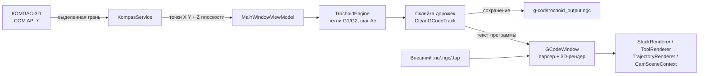

# TrochoidCam (KompasTrochoidCam)

> Настольное Windows-приложение для генерации и интерактивной 3D‑визуализации **трохоидальных траекторий фрезерования**. Оно подключается к запущенному КОМПАС‑3D, считывает контур выделенной плоской грани, строит управляющую программу в G‑коде (диалект LinuxCNC) и показывает покадровую симуляцию обработки заготовки.

Проект представляет собой исследовательский прототип CAM‑системы «мини‑iMachining»: вместо сложной библиотеки геометрии здесь прозрачный, читаемый алгоритм, который удобно изучать и дорабатывать.

**Репозиторий:** https://github.com/MrLait/TrochoidCam

---

## Содержание

- [Возможности](#возможности)
- [Стек технологий](#стек-технологий)
- [Требования](#требования)
- [Сборка и запуск](#сборка-и-запуск)
- [Как пользоваться](#как-пользоваться)
- [Управление симулятором](#управление-симулятором)
- [Как это работает](#как-это-работает)
- [Формат выходного G-кода](#формат-выходного-g-кода)
- [Структура проекта](#структура-проекта)
- [Постпроцессоры](#постпроцессоры)
- [Ограничения и известные особенности](#ограничения-и-известные-особенности)
- [Идеи для развития](#идеи-для-развития)
- [Лицензия](#лицензия)

---

## Возможности

- **Подключение к КОМПАС‑3D по COM.** Приложение находит уже запущенный экземпляр КОМПАС (API v7) через `GetActiveObject` из `oleaut32.dll` и работает с активным документом через позднее связывание — ссылки на COM‑библиотеки АСКОН в проекте не требуются.
- **Чтение геометрии.** Из выделенной плоской грани детали извлекаются рёбра внешнего контура и высота плоскости `Z`.
- **Генерация трохоиды.** Для каждого ребра контура строится цепочка круговых петель `G2` с заданными диаметром фрезы `D`, шагом `Ae`, оборотами `S` и подачей `F`. Результат сохраняется в `trochoid_output.ngc`.
- **Демо‑режим без CAD.** Если КОМПАС не запущен или грань не выделена, используется встроенный тестовый контур плиты ~90×124 мм — приложением можно пользоваться без установленного КОМПАС‑3D.
- **Интерактивный G‑код + 3D‑симулятор.**
  - список кадров слева синхронизирован с положением инструмента; клик по строке или наведение на траекторию подсвечивает кадр;
  - 3D‑холст: рабочие перемещения (голубые), быстрые перемещения (красные), выделенный кадр (жёлтый), объёмная фреза‑цилиндр, сетка заготовки со «снятым» материалом, оси координат X/Y/Z;
  - вращение, панорамирование и масштабирование мышью;
  - плеер: Пуск / Пауза / Стоп, покадровый шаг вперёд‑назад, ускорение 1×…25×;
  - габариты `X/Y/Z`, оценка времени обработки, копирование программы в буфер обмена.
- **Импорт сторонних программ.** Файлы `.nc`, `.ngc`, `.tap`, `.gcode` открываются в том же симуляторе; каталог `POSTPROCESSORS/` с шаблонами постпроцессоров копируется в выходной каталог при сборке.

---

## Стек технологий

| Компонент | Версия / значение |
| --- | --- |
| Язык, платформа | C#, .NET 10 (`net10.0-windows`), `WinExe` |
| UI | Avalonia UI 12.1.4 (FluentTheme, шрифт Inter, `ViewLocator`) |
| MVVM | CommunityToolkit.Mvvm 8.4.2 (`[ObservableProperty]`, `[RelayCommand]`) |
| Интеграция с CAD | COM API КОМПАС‑3D v7, `System.Reflection` + P/Invoke `oleaut32.dll` |
| Прочее | `System.Management` 10.0.13, `AvaloniaUI.DiagnosticsSupport` (только Debug) |
| Решение | `KompasTrochoidCam.slnx`, манифест `app.manifest` (Windows 10) |

Архитектура — классический MVVM: `Views` (AXAML) ⇄ `ViewModels` → `Services` (геометрия, COM, рендеринг).

---

## Требования

| Что | Зачем |
| --- | --- |
| **Windows 10/11** | `net10.0-windows`, `app.manifest`, COM и `oleaut32.dll` — только Windows |
| **.NET 10 SDK** | сборка; для запуска готовой сборки достаточно .NET 10 Desktop Runtime |
| **КОМПАС‑3D с API v7** (в коде указан диапазон v17–v23) | нужен **только** для чтения реального контура детали; должен быть запущен, с открытым документом детали (`.m3d`) |
| Станок/стойка с LinuxCNC‑совместимым G‑кодом | для запуска сгенерированной УП (само приложение станок не эмулирует) |

> Несмотря на заголовок главного окна «Плагин для КОМПАС‑3D», это **отдельное приложение**, а не встраиваемая в КОМПАС библиотека.

---

## Сборка и запуск

```powershell
git clone https://github.com/MrLait/TrochoidCam.git
cd TrochoidCam

dotnet restore
dotnet build -c Release
dotnet run --project KompasTrochoidCam.csproj
```

Также решение `KompasTrochoidCam.slnx` можно открыть в Visual Studio 2022 (актуальная версия) / Visual Studio 2026, Rider или VS Code с C# Dev Kit и собрать через IDE (F5).

При сборке все файлы из `POSTPROCESSORS/` автоматически копируются в `bin/<Configuration>/net10.0-windows/POSTPROCESSORS/` (`PreserveNewest`). Если каталог отсутствует рядом с исполняемым файлом, приложение создаёт его само. Список доступных постпроцессоров читается один раз при старте, поэтому новые файлы появятся в выпадающем списке после перезапуска программы.

---

## Как пользоваться

### 1. Генерация УП по детали из КОМПАС‑3D

1. Запустите КОМПАС‑3D, откройте деталь (`.m3d`) и **выделите плоскую грань**, контур которой нужно обработать.
2. Запустите TrochoidCam, нажмите **«Подключиться к КОМПАС»** — статус станет зелёным и покажет имя документа. Если подключение не удалось, в поле статуса будет выведена причина (нет COM‑сервера, нет открытой детали и т. д.).
3. Заполните параметры (десятичный разделитель — **точка**):
   - **Диаметр фрезы, мм** — по умолчанию `10.0`;
   - **Шаг трохоиды Ae, мм** — по умолчанию `1.0` (смещение центра каждой следующей петли);
   - **Обороты S, об/мин** — по умолчанию `6000`;
   - **Подача F, мм/мин** — по умолчанию `400`.
4. Нажмите **«Считать контур и создать .ngc»**. Программа будет записана в файл `trochoid_output.ngc` в каталоге `g-cod` (особенности его расположения — в [п. 6 ограничений](#ограничения-и-известные-особенности)) и сразу откроется в окне симулятора.

### 2. Демо‑режим без КОМПАС‑3D

Можно ничего не подключать: если выделенной грани нет, генерация выполняется по встроенному прямоугольному контуру (≈90×124 мм, плоскость `Z0`). Это удобно для проверки параметров и работы симулятора на компьютере без КОМПАС.

### 3. Импорт готового G‑кода

1. В блоке «Постпроцессор станка» выберите файл из `POSTPROCESSORS/` (например, `HAAS.py3`) — кнопка импорта станет активной.
2. Нажмите **«Открыть сторонний G‑код (.nc / .ngc)»** и выберите файл `.nc`, `.ngc`, `.tap` или `.gcode`.
3. Файл будет разобран и показан в симуляторе. Обратите внимание: **преобразование кода выбранным постпроцессором сейчас не выполняется** — имя файла используется только как метка станка в диалоге (см. [ограничения](#ограничения-и-известные-особенности)).

---

## Управление симулятором

| Действие | Результат |
| --- | --- |
| Клик по строке в списке G‑кода | переход к кадру, подсветка соответствующего участка траектории |
| Наведение курсора на траекторию | подсветка ближайшего кадра (в радиусе 5 px) |
| **Правая кнопка мыши + перетаскивание** | вращение сцены (углы `RotZ` / `RotX`) |
| **Средняя кнопка мыши + перетаскивание** | панорамирование (сдвиг `OffsetX` / `OffsetY`) |
| **Колесо мыши** | масштаб (0.1…200, Zoom к курсору) |
| ⏸ Пауза / ▶ Пуск / ⏮ Стоп | управление проигрыванием (шаг таймера 30 мс) |
| ◀ Кадр Назад / Кадр Вперед ▶ | покадровый просмотр |
| Скорость 1× / 2× / 5× / 10× / 25× | число точек траектории за тик таймера |
| «Копировать в буфер» | копирование всего текста программы |

Информационная панель показывает габариты по осям, расчётное время обработки и текущий номер точки траектории.

---

## Как это работает



Симулятор получает текст программы напрямую из генератора — файл `.ngc` сохраняется параллельно и не перечитывается.

### Алгоритм трохоиды

Для каждого ребра контура `A → B` (`TrochoidEngine.GenerateLinearTrochoid`):

1. Строится единичный вектор направления `u = (B − A) / |B − A|` и нормаль `n = (−u_y, u_x)`.
2. Радиус петли `r = D / 2`.
3. Центр `k`-й петли: `C_k = A + u · (k · Ae)`. Точка входа `P = C_k + n · r`.
4. Выводится `G1 X… Y…` в точку входа, затем полная окружность `G2` с относительными координатами центра `I = C_x − P_x`, `J = C_y − P_y` (возврат в ту же точку). Полный круг, а не дуга, обеспечивает постоянную толщину стружки и плавное движение приводов.
5. Центр смещается на `Ae`, цикл повторяется, пока не пройдена вся длина ребра.

`MainWindowViewModel` обходит все рёбра контура, склеивает дорожки, выбрасывает из них шапки/хвосты (`CleanGCodeTrack`) и подставляет реальную высоту плоскости `Z` вместо `Z0.0`. Итоговая программа имеет общую шапку (`G90 G40 G17`, `S… F… M3`, `G54`, `G0 Z50.0`) и финал (`G0 Z50.0`, `M9`, `M5`, `M30`, `%`). Координаты петель форматируются через `InvariantCulture`, то есть с точкой как десятичным разделителем; единственное исключение — строка врезания `G1 Z… F50` (см. [ограничения](#ограничения-и-известные-особенности)).

### Симуляция

- `CamSceneContext` — собственная проекция 3D→2D: поворот вокруг Z, затем вокруг X, умножение на масштаб и перенос в центр `Canvas`.
- `StockRenderer` — карта высот 100×100 для заготовки 110×140×20 мм (X: −55…55, Y: −70…70). `CutMaterial` понижает высоту ячеек в радиусе фрезы; сетка рисуется светлой для нетронутого материала и тёмной для выбранного.
- `ToolRenderer` — фреза как цилиндр (16 сегментов) с перекрестием оси шпинделя.
- `TrajectoryRenderer` — три слоя: рабочие перемещения (`Z ≤ 0.1`, голубой, 2.2 px), быстрые (`Z > 0.1`, красный, 0.8 px) и выделенный кадр (жёлтый, 4.5 px).
- Парсер `GCodeWindow.ParseAndBuildTrajectory` читает `G0/G1/G2`, координаты `X/Y/Z`, подачу `F`; дуги `G2` аппроксимируются 12 отрезками. Время обработки считается как `длина / F` (для `G0` — 5000 мм/мин), для дуг — `2πr / F`.

---

## Формат выходного G-кода

Пример для демонстрационного контура и параметров по умолчанию (`g-cod/trochoid_output.ngc`):

```gcode
%
( Mini-iMachining Face Path for LinuxCNC )
G90 G40 G17
S6000 F400 M3
G54
G0 Z50.0
G0 X-50.723 Y-63.490
G1 Z0.000 F50
G1 X-45.723 Y-58.490 F400
G2 X-45.723 Y-58.490 I0.000 J-5.000
G1 X-44.723 Y-58.490 F400
G2 X-44.723 Y-58.490 I0.000 J-5.000
...
G0 Z50.0
M9
M5
M30
%
```

Единицы — миллиметры, абсолютные координаты (`G90`), плоскость `XY` (`G17`), рабочая система координат `G54`, вращение шпинделя по часовой стрелке (`M3`).

---

## Структура проекта

```
TrochoidCam/
├── App.axaml / App.axaml.cs        # приложение Avalonia, темы, главное окно
├── Program.cs                      # Main + BuildAvaloniaApp
├── ViewLocator.cs                  # сопоставление ViewModel → View
├── app.manifest                    # манифест совместимости Windows
├── KompasTrochoidCam.csproj        # .NET 10, пакеты, копирование POSTPROCESSORS
├── KompasTrochoidCam.slnx          # решение
├── Assets/                         # иконка приложения
├── POSTPROCESSORS/
│   └── HAAS.py3                    # шаблон постпроцессора HAAS (cp1251)
├── Services/
│   ├── KompasService.cs            # COM-подключение к КОМПАС-3D, чтение грани
│   ├── TrochoidEngine.cs           # генерация трохоидальных G1/G2-петель
│   ├── CamSceneContext.cs          # 3D → 2D проекция, повороты, масштаб
│   ├── StockRenderer.cs            # карта высот заготовки + визуализация съёма
│   ├── ToolRenderer.cs             # 3D-фреза
│   └── TrajectoryRenderer.cs       # слои траекторий G0/G1/G2
├── ViewModels/
│   ├── ViewModelBase.cs
│   ├── MainWindowViewModel.cs      # параметры, подключение, генерация, импорт
│   └── GCodeWindowViewModel.cs     # текст/строки G-кода, габариты, статистика
├── Views/
│   ├── MainWindow.axaml(.cs)       # форма настроек (D, Ae, S, F, статус, посты)
│   └── GCodeWindow.axaml(.cs)      # симулятор: парсер, плеер, мышь, отрисовка
└── g-cod/                          # создаётся при работе: trochoid_output.ngc (в .gitignore)
```

---

## Постпроцессоры

Каталог `POSTPROCESSORS/` — это «библиотека станков»: все файлы из него попадают в выпадающий список главного окна. В комплекте идёт `HAAS.py3` — унаследованный шаблон постпроцессора (`VERSION 18`, расширение `.nc`, кодировка cp1251) с описанием кадров `G00/G01/G02/G03`, циклов и M‑кодов; его Python‑часть читает `input.tmp` и пишет `output.tmp`.

**Важно:** приложение не запускает эти файлы и не применяет их к программе. Сейчас выбор постпроцессора:

- разблокирует кнопку импорта и подставляет имя файла в заголовок диалога;
- не меняет синтаксис импортированного G‑кода.

Генератор (`TrochoidEngine`) всегда выдаёт LinuxCNC‑совместимый код напрямую. Если нужен код для HAAS/Fanuc/Siemens, преобразование выполняется отдельно (например, внешним постпроцессором) или требуется доработка конвейера в коде.

---

## Ограничения и известные особенности

Прототип написан «для себя», поэтому перед использованием на реальном станке обязательно проверяйте программу в симуляторе станка и на холостом прогоне.

1. **Только Windows.** COM‑интеграция, `net10.0-windows` и `app.manifest` исключают Linux/macOS. Симулятор теоретически кроссплатформенный, но собирается в одном проекте с Windows‑специфичным кодом.
2. **COM‑подключение чувствительно к окружению.** КОМПАС‑3D должен быть запущен под тем же пользователем и с тем же уровнем прав (администратор/обычный), что и приложение; в КОМПАС должна быть открыта деталь. Проверка `ConnectionStatus.StartsWith("Подключено")` в команде генерации **временно закомментирована** — генерация возможна без подключения, с демонстрационным контуром.
3. **Геометрия читается упрощённо.** Берётся первый выделенный объект, только грань (`ObjectType = 4`) с плоской поверхностью (`SurfaceType = 1`), только внешний контур (`Loops[0]`) и только начальные точки рёбер `PointStart`. Криволинейные рёбра превращаются в ломаную по начальным точкам, коррекции на радиус инструмента и припусков нет, отверстия/внутренние контуры не обрабатываются.
4. **Постпроцессоры не исполняются** (см. раздел выше); формат `HAAS.py3` приведён как образец/заготовка.
5. **Парсер G‑кода поддерживает минимум:** `G0`, `G1`, `G2`, `X/Y/Z/I/J/F`; игнорируются `G3`, `G91`, дюймы, коррекция на радиус (`G41/G42`), постоянные циклы, смена инструмента, подпрограммы. Дуга `G2` всегда разворачивается в полную окружность из 12 отрезков, конечная точка кадра не учитывается. Цвет «быстрого» перемещения определяется не командой `G0`, а условием `Z > 0.1`.
6. **Путь вывода жёстко задан.** Каталог `g-cod` вычисляется как четыре уровня вверх от `AppDomain.CurrentDomain.BaseDirectory`. В текущей структуре репозитория (`.csproj` лежит в корне, сборка — `bin/Debug/net10.0-windows/`) это приводит **в родительский по отношению к репозиторию каталог**, а не в сам проект; при публикации/запуске из другой папки результат будет ещё отличаться. Надёжнее сохранять файл через `SaveFileDialog` или рядом с исполняемым файлом.
7. **Локаль и разделители.** Поля параметров разбираются через `InvariantCulture` — вводите `10.0`, а не `10,0`, иначе появится «Ошибка расчета». При этом строка врезания `G1 Z{faceZ:F3} F50` форматируется через текущую культуру, поэтому на системе с десятичной запятой в неё может попасть `0,000`; проверяйте сгенерированный файл или используйте `InvariantCulture`.
8. **Симуляция — визуализация, а не CAM‑верификатор.** Размеры заготовки (110×140×20 мм), диаметр/высота фрезы и начальная точка заданы константами; нет контроля столкновений, врезания, вылетов инструмента, ускорений и реальной кинематики. Оценка времени — приблизительная, без разгона/торможения.
9. **Нет тестов, CI и файла лицензии.** Код содержит отладочные комментарии и дублирующиеся участки; это нормальная стадия прототипа, но не инструмент, готовый к промышленной эксплуатации.

---

## Идеи для развития

- [ ] Расширить парсер: `G3`, `G91`, `G20/G21`, `G41/G42`, циклы, смена инструмента, комментарии.
- [ ] Реальный конвейер постпроцессоров (применение шаблона к сгенерированной траектории).
- [ ] Диалог сохранения УП и явный выбор каталога вместо «четырёх уровней вверх».
- [ ] Чтение криволинейных рёбер (интерполяция дуг/сплайнов), внутренних контуров и нескольких граней; стратегии карманов и послойная обработка.
- [ ] Настраиваемые размеры заготовки, материала, вылета фрезы, безопасной высоты; сохранение настроек.
- [ ] Инвариантное форматирование всех чисел и валидация ввода с понятными сообщениями.
- [ ] Модульные тесты `TrochoidEngine` и парсера, отделение симулятора от Windows‑зависимого COM‑слоя.
- [ ] Экспорт скриншотов/видео симуляции и сохранение проекта.

---

## Лицензия

В репозитории нет файла `LICENSE`; условия использования не определены. Перед использованием или распространением уточните их у автора проекта: [MrLait](https://github.com/MrLait).
