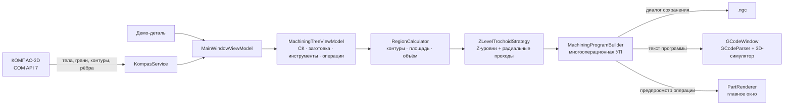

# TrochoidCam (KompasTrochoidCam)

> Автономное Windows‑приложение для **2.5D‑фрезерования трохоидальными траекториями по Z‑уровням**. Оно подключается к запущенному КОМПАС‑3D по COM, загружает геометрию детали в своё рабочее окно, позволяет выбрать грани и рёбра области обработки, построить дерево операций с инструментами и получить управляющую программу в G‑коде вместе с интерактивной 3D‑визуализацией.

Проект — исследовательский прототип CAM‑системы «мини‑iMachining»: вместо тяжёлой геометрической библиотеки здесь прозрачные, читаемые алгоритмы (смещение контура, петли трохоиды, карта высот заготовки), которые удобно изучать и дорабатывать.

**Репозиторий:** https://github.com/MrLait/TrochoidCam

---

## Содержание

- [Возможности](#возможности)
- [Стек технологий](#стек-технологий)
- [Требования](#требования)
- [Сборка и запуск](#сборка-и-запуск)
- [Интерфейс](#интерфейс)
- [Как пользоваться](#как-пользоваться)
- [Дерево плана обработки](#дерево-плана-обработки)
- [Область обработки и объём съёма](#область-обработки-и-объём-съёма)
- [Управление симулятором](#управление-симулятором)
- [Как это работает](#как-это-работает)
- [Формат выходного G-кода](#формат-выходного-g-кода)
- [Проект и сохранение](#проект-и-сохранение)
- [Структура проекта](#структура-проекта)
- [Постпроцессоры](#постпроцессоры)
- [Ограничения и известные особенности](#ограничения-и-известные-особенности)
- [Планы и история](#планы-и-история)
- [Лицензия](#лицензия)

---

## Возможности

- **Автономный режим (без встраивания в КОМПАС).** Приложение не является плагином: оно подключается к уже запущенному КОМПАС‑3D V19 (и другим версиям с API v7) и работает как отдельная CAM‑программа.
- **Загрузка всей геометрии детали.** Из активного документа читаются тела, плоские грани (`SurfaceType = 1`) со всеми контурами (внешними и внутренними), рёбра‑отрезки и рёбра‑дуги. Геометрия сразу отображается в рабочем окне.
- **Кнопка «Обновить геометрию».** Повторно читает активный документ, поэтому изменения 3D‑модели в КОМПАС подхватываются без перезапуска. Выделение области обработки, где это возможно, сохраняется.
- **Демо‑деталь.** Без КОМПАС приложение стартует с плитой 90×124×20 мм, карманом 60×80 мм и отверстием Ø16 — все функции доступны на машине без установленного КОМПАС.
- **Выбор области обработки.** Грани и рёбра отмечаются в правой панели; по выбору строится контур области и оцениваются площадь, глубина и **объём снимаемого металла** (площадь × глубина).
- **Дерево плана обработки** (аналог «ЧПУ — Фрезерная обработка» КОМПАС):
  - система координат: станок (`IvanHAAS`), ЛСК (`ЛСК3`), рабочая СК (`G54`);
  - заготовка с настраиваемыми габаритами и припуском;
  - библиотека инструментов с T‑номерами, типами и диаметрами;
  - операции фрезерования, привязанные к инструменту, с параметрами `S`, `F`, коррекцией `r`, шагом `Ae`, шагом по глубине `ΔZ`, `Z`‑уровнями, припуском и радиальным шагом;
  - добавление, удаление, переименование, изменение порядка, свёртывание/развёртывание, выделение и контекстное меню (правая кнопка мыши);
  - один инструмент может использоваться в нескольких операциях, а порядок операций задаёт последовательность обработки независимо от T‑номеров.
- **Трохоидальная стратегия по Z‑уровням.** На каждом уровне глубины контур смещается внутрь на радиус фрезы + припуск, выполняются радиальные проходы очистки, а вдоль контура — полные петли `G2` с шагом `Ae`.
- **Многооперационная УП.** Для каждой операции выводится смена инструмента `T… M6`, свои `S`/`F` и блок Z‑уровней; программа сохраняется через диалог в `.ngc` (по умолчанию предлагается `trochoid_output.ngc`).
- **Предпросмотр выбранной операции** прямо на 3D‑модели в главном окне: заготовка, грани детали, выделенная область (жёлтый), траектория (зелёный), быстрые перемещения (красный).
- **Симулятор обработки** (второе окно): список кадров, подсветка кадра, плеер, покадровый шаг, скорости 1×…25×, съём материала картой высот, габариты, оценка времени.
- **Проект `.tcplan`.** План (система координат, заготовка, инструменты, операции, выбранная область) и геометрия сохраняются в один JSON‑файл и открываются вместе.
- **Импорт сторонних программ.** Файлы `.nc`, `.ngc`, `.tap`, `.gcode` открываются в симуляторе; парсер понимает `G0/G1/G2/G3`, `G90/G91`, `G20/G21`, дуги по `I/J` и `R`.

---

## Стек технологий

| Компонент | Версия / значение |
| --- | --- |
| Язык, платформа | C#, .NET 10 (`net10.0-windows`), `WinExe` |
| UI | Avalonia UI 12.1.4 (FluentTheme, шрифт Inter, `ViewLocator`) |
| MVVM | CommunityToolkit.Mvvm 8.4.2 (`[ObservableProperty]`, `[RelayCommand]`) |
| Интеграция с CAD | COM API КОМПАС‑3D v7, `System.Reflection` + P/Invoke `oleaut32.dll` |
| Хранение проекта | `System.Text.Json`, файл `.tcplan` |
| Прочее | `System.Management` 10.0.13, `AvaloniaUI.DiagnosticsSupport` (только Debug) |
| Решение | `KompasTrochoidCam.slnx`, манифест `app.manifest` (Windows 10) |

Архитектура — MVVM: `Views` (AXAML) ⇄ `ViewModels` ⇄ `Models` (план, геометрия) → `Services` (COM, геометрия, стратегия, G‑код, рендеринг).

---

## Требования

| Что | Зачем |
| --- | --- |
| **Windows 10/11** | `net10.0-windows`, `app.manifest`, COM и `oleaut32.dll` — только Windows |
| **.NET 10 SDK** | сборка; для запуска готовой сборки достаточно .NET 10 Desktop Runtime |
| **КОМПАС‑3D с API v7** (в коде указан диапазон v17–v23) | нужен **только** для чтения реальной геометрии; должен быть запущен, с открытым документом детали (`.m3d`) |
| Станок/стойка с LinuxCNC‑совместимым G‑кодом | для запуска сгенерированной УП (само приложение станок не эмулирует) |

---

## Сборка и запуск

```powershell
git clone https://github.com/MrLait/TrochoidCam.git
cd TrochoidCam

dotnet restore
dotnet build -c Release
dotnet run --project KompasTrochoidCam.csproj
```

Решение `KompasTrochoidCam.slnx` открывается в Visual Studio 2022/2026, Rider или VS Code с C# Dev Kit.

При сборке файлы из `POSTPROCESSORS/` копируются в `bin/<Configuration>/net10.0-windows/POSTPROCESSORS/` (`PreserveNewest`); если каталога нет рядом с исполняемым файлом, приложение создаёт его само. Список постпроцессоров читается при старте, новые файлы появляются в списке после перезапуска.

---

## Интерфейс

Главное окно разделено на три колонки:

| Зона | Содержимое |
| --- | --- |
| **Слева** | дерево плана обработки и кнопки `+ Операция`, `+ Инструмент`, `Удалить`, `▲`, `▼` |
| **В центре** | 3D‑сцена: заготовка, геометрия детали, область обработки, траектория выбранной операции |
| **Справа** | свойства выбранного узла: операция, инструмент, заготовка или область обработки; блок импорта УП |
| **Сверху** | подключение к КОМПАС, обновление геометрии, демо‑деталь, открытие/сохранение плана, формирование УП, симулятор |
| **Снизу** | строка статуса с результатом последнего действия |

Управление сценой: **ЛКМ** — вращение, **СКМ** — панорамирование, **колесо** — масштаб к курсору.

---

## Как пользоваться

### 1. Работа с КОМПАС‑3D

1. Запустите КОМПАС‑3D и откройте деталь (`.m3d`).
2. В TrochoidCam нажмите **«Подключиться к КОМПАС»** — после успешного подключения геометрия читается сразу.
3. Если модель в КОМПАС изменилась, нажмите **«Обновить геометрию»** — документ перечитывается без перезапуска приложения.
4. Если КОМПАС не запущен или документ не открыт, приложение показывает демо‑деталь и предупреждение в статусе.

### 2. Область обработки

1. Выберите в дереве узел **«Область обработки»**.
2. Отметьте грани (и при необходимости рёбра), ограничивающие зону съёма металла.
3. Панель покажет площадь, глубину и объём снимаемого материала. Кнопка **«Z дна по грани»** переносит `Z` выбранной грани в текущую операцию.

### 3. Дерево и операции

1. **«+ Операция»** создаёт операцию с текущим инструментом; **«+ Инструмент»** добавляет новую позицию в магазин.
2. Двойной щелчок по узлу — переименование; правая кнопка — контекстное меню (добавить, переименовать, выше/ниже, удалить).
3. В правой панели настройте инструмент, `S`, `F`, коррекцию `r`, `Ae`, `ΔZ`, `Z` начала и дна, припуск, радиальный шаг и безопасную высоту.
4. Траектория выбранной операции пересчитывается автоматически и показывается на 3D‑модели.

### 4. Формирование УП

1. Нажмите **«Сформировать УП»**.
2. Выберите путь сохранения (по умолчанию `trochoid_output.ngc`). Если диалог недоступен, файл пишется в `g-cod` рядом с исполняемым файлом.
3. Программа сразу открывается в симуляторе; в статусе отображаются число операций, длина резания и оценка времени.

### 5. Проект

- **«Сохранить план»** — файл `.tcplan` с планом и геометрией.
- **«Открыть план»** — восстанавливает дерево, инструменты, операции, выбранную область и модель (без повторного чтения КОМПАС).

---

## Дерево плана обработки

Структура повторяет логику модуля «ЧПУ — Фрезерная обработка» КОМПАС‑3D:

```text
План фрезерной обработки
├── Система координат
│   ├── Станок: IvanHAAS            (рабочая СК: G54)
│   └── ЛСК ЧПУ: ЛСК3
├── Заготовка, инструменты
│   ├── Заготовка: 99.9 × 134.5 × 20.0 мм
│   └── Инструменты: 3 поз.
│       ├── T1 — Фреза ГОСТ 17025   (Ø4)
│       ├── T2 — Фреза ГОСТ 17025   (Ø6)
│       └── T3 — Фреза нестандартная (Ø5.5)
├── Область обработки               (площадь · глубина · объём)
├── 1. Фрезерование d5.5            T3 · S=10000 · F=1000 · r=0
├── 2. Фрезерование d4              T1 · S=10000 · F=1000 · r=0
└── 3. Фрезерование d6              T2 · S=10000 · F=1000 · r=0
```

**Инструменты и операции разделены:** T‑номер — это позиция в магазине, а порядок операций задаёт последовательность обработки. Один инструмент может встречаться в нескольких операциях.

---

## Область обработки и объём съёма

- Для каждой выбранной плоской грани берётся её внешний контур; для выбранных рёбер выполняется сшивка в замкнутые цепочки по совпадению концов.
- Площадь считается по формуле шнурков; для граней вычитаются внутренние контуры (отверстия).
- Объём снимаемого металла оценивается как **площадь × (Z начала − Z дна)** — это оценка по призме, а не результат логической операции вычитания тел.
- Если ничего не выбрано, автоматически берётся самая нижняя горизонтальная грань с нормалью вверх (в демо‑детали — дно кармана).

---

## Управление симулятором

| Действие | Результат |
| --- | --- |
| Клик по строке в списке G‑кода | переход к кадру, подсветка участка траектории |
| Наведение курсора на траекторию | подсветка ближайшего кадра (радиус 5 px) |
| **ПКМ + перетаскивание** | вращение сцены |
| **СКМ + перетаскивание** | панорамирование |
| **Колесо мыши** | масштаб (0.1…200, к курсору) |
| ⏸ Пауза / ▶ Пуск / ⏮ Стоп | управление проигрыванием (таймер 30 мс) |
| ◀ Кадр Назад / Кадр Вперед ▶ | покадровый просмотр |
| Скорость 1× / 2× / 5× / 10× / 25× | число точек траектории за тик |
| «Копировать в буфер» | копирование текста программы |

---

## Как это работает



### Стратегия по Z-уровням

Для операции с параметрами `ZTop`, `ZBottom`, `ΔZ`, `Ae`, припуском и радиальным шагом:

1. Число уровней `N = ceil((ZTop − ZBottom) / ΔZ)`; уровни идут от `ZTop − ΔZ` до `ZBottom` включительно.
2. На каждом уровне контур области смещается внутрь на `r_инстр + припуск + k · радиальный шаг` (`k = 0, 1, 2, …`) — это проходы очистки.
3. Вдоль каждого смещённого контура строятся петли: центр петли перемещается по контуру с шагом `Ae`, точка входа — `C + n · r_инстр`, выводится полная окружность `G2` с `I/J` (относительный центр).
4. Между петлями и уровнями инструмент отводится на безопасную `Z`, чтобы не «протягивать» фрезу через материал.
5. Смещение контура — «miter»‑offset: каждое ребро сдвигается по нормали, соседние прямые пересекаются. При вырождении (контур схлопнулся) проход прекращается.

### Координаты

- Геометрия, заготовка и операции хранятся в **абсолютных координатах детали** (как в КОМПАС).
- В УП `Z` пересчитывается от **верха заготовки**: `Z_программы = Z_детали − Stock.TopZ`. Поэтому верх заготовки — это `Z0`, а карман глубиной 10 мм даёт `Z −10`.
- В симуляторе заготовка строится в программных координатах: верх `Z0`, низ — ниже самой глубокой точки программы.

### Парсер G-кода

`Services/GCodeParser.cs` — общий разборщик для симулятора и предпросмотра:

- `G0/G1` — линейные перемещения, `G2/G3` — дуги по `I/J` или `R`;
- `G90/G91` — абсолютные/относительные координаты, `G20/G21` — дюймы/миллиметры;
- дуга аппроксимируется отрезками примерно по 15°; полная окружность распознаётся по совпадению начала и конца;
- время оценивается как `длина / подача`, для `G0` — 5000 мм/мин.

---

## Формат выходного G-кода

Фрагмент программы для демо‑плана (первая операция, `D=5.5`, `S=10000`, `F=1000`):

```gcode
%
( TrochoidCam — 2.5D трохоидальная обработка по Z-уровням )
( План: План фрезерной обработки )
( Станок: IvanHAAS · ЛСК: ЛСК3 )
( Заготовка: 99.9 x 134.5 x 20.0 мм )
( Z отсчитывается от верха заготовки, Z0 = верх )
G21 G90 G40 G17
G54
G0 Z50.000

( ===== Операция 1: Фрезерование d5.5 ===== )
( Инструмент T3 · Фреза нестандартная · Ø5.50 мм )
( S=10000 об/мин · F=1000 мм/мин · коррекция r=0.00 )
( Z: 20.000 → 10.000 · шаг 2.00 · Ae=1.00 · припуск 0.20 )
T3 M6
S10000 M3
G0 Z50.000
( --- уровень 1/5: Z=18.000 --- )
G0 Z50.000
G0 X-27.050 Y-34.300
G1 Z-2.000 F50.000
G2 X-27.050 Y-34.300 I0.000 J-2.750 F1000.000
G1 X-26.050 Y-34.300 F1000.000
G2 X-26.050 Y-34.300 I0.000 J-2.750 F1000.000
...
G0 Z50.000
M5
G0 Z50.000
M9
M5
M30
%
```

Единицы — миллиметры, абсолютные координаты, плоскость `XY`, рабочая система координат из настроек (`G54` по умолчанию), вращение шпинделя по часовой стрелке (`M3`).

---

## Проект и сохранение

Файл `.tcplan` — это JSON:

```json
{
  "Version": 1,
  "Plan": {
    "Name": "План фрезерной обработки",
    "CoordinateSystem": { "MachineName": "IvanHAAS", "LocalCsName": "ЛСК3", "WorkOffset": "G54" },
    "Stock": { "MinX": -50.7, "MaxX": 49.2, "MinY": -68.5, "MaxY": 66.0, "TopZ": 20.0, "BottomZ": 0.0 },
    "Tools": [ { "Number": 1, "Name": "Фреза ГОСТ 17025", "Diameter": 4.0 } ],
    "Operations": [ { "Name": "Фрезерование d5.5", "ToolNumber": 3, "SpindleSpeed": 10000, "Feed": 1000 } ],
    "SelectedFaceIds": [ 2 ],
    "SelectedEdgeIds": []
  },
  "Geometry": { "DocumentName": "Демо-деталь", "Faces": [], "Edges": [] }
}
```

Сохранение включает геометрию, поэтому проект открывается и на машине без КОМПАС.

---

## Структура проекта

```text
TrochoidCam/
├── App.axaml / App.axaml.cs          # приложение Avalonia, главное окно
├── Program.cs                        # Main + BuildAvaloniaApp
├── ViewLocator.cs                    # ViewModel → View
├── app.manifest                      # манифест Windows
├── KompasTrochoidCam.csproj          # .NET 10, пакеты, копирование POSTPROCESSORS
├── Assets/                           # иконка
├── docs/
│   └── FEATURE-trochoid-z-levels.md  # спецификация и история решения
├── POSTPROCESSORS/
│   └── HAAS.py3                      # унаследованный шаблон постпроцессора (cp1251)
├── Models/
│   ├── PartGeometry.cs               # грани, контуры, рёбра, габариты
│   └── MachiningPlan.cs              # план, инструменты, операции, заготовка, СК
├── Services/
│   ├── KompasService.cs              # COM API 7: подключение, чтение всей геометрии
│   ├── DemoGeometryFactory.cs        # демо-деталь (плита + карман + отверстие)
│   ├── GeometryMath.cs               # площади, нормализация контуров, дуги
│   ├── PolygonOffset.cs              # смещение контура внутрь (miter)
│   ├── RegionCalculator.cs           # область обработки, площадь, объём
│   ├── ZLevelTrochoidStrategy.cs     # стратегия Z-уровней и петли G2
│   ├── MachiningProgramBuilder.cs    # сборка многооперационной УП
│   ├── GCodeParser.cs                # общий парсер G0/G1/G2/G3
│   ├── PlanFileService.cs            # сохранение/загрузка .tcplan
│   ├── PartRenderer.cs               # отрисовка детали, области и траектории
│   ├── CamSceneContext.cs            # проекция 3D → 2D, вписывание сцены
│   ├── StockRenderer.cs              # карта высот заготовки (симулятор)
│   ├── ToolRenderer.cs               # фреза-цилиндр
│   ├── TrajectoryRenderer.cs         # слои траекторий в симуляторе
│   └── TrochoidEngine.cs             # первый генератор петель (оставлен для истории)
├── ViewModels/
│   ├── MainWindowViewModel.cs        # команды, геометрия, регион, УП, проект
│   ├── MachiningTreeViewModel.cs     # дерево плана, узлы, команды редактирования
│   ├── GeometryItem.cs               # строка выбора грани/ребра
│   └── GCodeWindowViewModel.cs       # текст УП, габариты, статистика
├── Views/
│   ├── MainWindow.axaml(.cs)         # три колонки: дерево, 3D-сцена, свойства
│   └── GCodeWindow.axaml(.cs)        # симулятор: список кадров, плеер, 3D
└── g-cod/                            # создаётся при работе (в .gitignore)
```

---

## Постпроцессоры

Каталог `POSTPROCESSORS/` — «библиотека станков»: все файлы из него попадают в выпадающий список. В комплекте `HAAS.py3` — унаследованный шаблон (`VERSION 18`, `.nc`, cp1251) с описанием кадров и циклов.

**Важно:** приложение по‑прежнему **не исполняет** эти файлы и не преобразует код. Выбор постпроцессора разблокирует импорт и попадает в заголовок диалога. Генерация (`MachiningProgramBuilder`) всегда выдаёт LinuxCNC‑совместимый код.

---

## Ограничения и известные особенности

Прототип развивается итерациями. Перед запуском на станке обязательно проверяйте УП в симуляторе стойки и на холостом прогоне.

1. **Только Windows.** COM, `net10.0-windows` и `app.manifest` исключают Linux/macOS.
2. **Сборка не проверялась в изолированной среде.** В песочнице, где готовился код, нет .NET 10 SDK; синтаксис проверен парсером, но полноценная компиляция и запуск выполняются на Windows‑машине разработчика. Автотестов и CI нет.
3. **Геометрия читается через COM‑рефлексию и зависит от версии API.** Читаются плоские грани (`SurfaceType = 1`) и рёбра тел. Если версия КОМПАС не отдаёт `Bodies`/`Faces`/`Edges`, список будет пуст — в статусе появится причина. Наклонные и криволинейные поверхности пропускаются.
4. **Дуги аппроксимируются.** Ребро‑дуга заменяется ломаной; при отсутствии явного направления выбирается кратчайшая дуга, полная окружность определяется по совпадению концов. Сплайны и эллипсы не поддерживаются.
5. **Смещение контура упрощённое.** Miter‑offset без удаления самопересечений: для узких мест и острых углов возможны артефакты; внутренние контуры (отверстия) в объёме учитываются, но инструментом не обходятся.
6. **Стратегия — не полноценная выборка кармана.** Трохоида идёт по смещённым контурам с радиальным шагом; в углах и в центре крупных областей может оставаться материал. Нет черновой/чистовой дифференциации, подвода по дуге и контроля перебега.
7. **Петли всегда `G2`.** Для полной окружности направление не влияет на геометрию, но для стоек с ограничениями по `I/J` (например, дуги ≤ 180°) может потребоваться адаптация постпроцессора.
8. **Предпросмотр ограничен.** Для отзывчивости интерфейса предпросмотр операции обрезается после 2500 петель и помечается как сокращённый; полная УП не ограничена.
9. **Симулятор — визуализация, а не верификатор.** Нет контроля столкновений, зажимов, вылета инструмента, ускорений и кинематики. Время приблизительное.
10. **Большие программы замедляют симулятор.** Отрисовка перестраивает всю траекторию на каждом кадре; для сотен тысяч точек возможны подвисания.
11. **Постпроцессоры не исполняются** (см. раздел выше).
12. **Нет тестов, CI и файла лицензии.** Код содержит отладочные участки и дублирование (например, старый `TrochoidEngine` рядом с новой стратегией).

---

## Планы и история

- **Этап 1 — автономный режим (реализовано).** Клиент отказался от встраивания кнопки в панель модуля ЧПУ КОМПАС и выбрал отдельное приложение: перехват всей геометрии, обновление, выбор области, дерево операций.
- **Этап 2 — трохоидальная обработка по Z-уровням (первая версия).** Реализованы уровни, радиальные проходы, смещение контура, многооперационная УП и предпросмотр.
- **Этап 3 — кнопка внутри КОМПАС (отменён заказчиком 25.10.2026).** Требует лицензионного модуля ЧПУ и SDK; при появлении доступа движок можно переиспользовать.

Ближайшие задачи:

- [ ] Валидация параметров с подсветкой полей и понятными сообщениями.
- [ ] Обход внутренних контуров (островов) и стратегия кармана с полной очисткой.
- [ ] Реальный конвейер постпроцессоров (шаблон → кадры → синтаксис стойки).
- [ ] Модульные тесты геометрии, смещения, стратегии и парсера; CI.
- [ ] Ускорение симулятора (инкрементальная отрисовка, ограничение кадров).
- [ ] Экспорт скриншотов/видео и отчёт по операции.

---

## Лицензия

В репозитории нет файла `LICENSE`; условия использования не определены. Перед использованием или распространением уточните их у автора проекта: [MrLait](https://github.com/MrLait).
